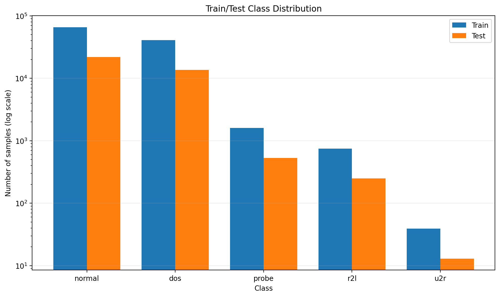
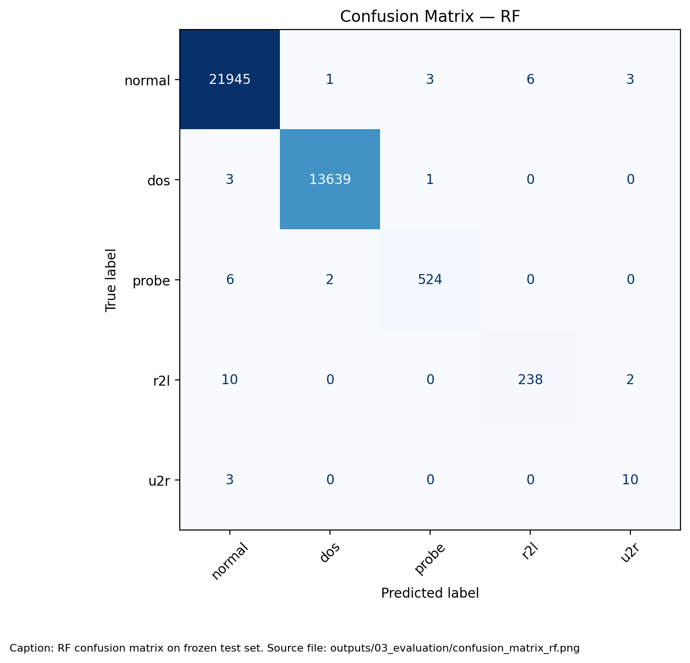
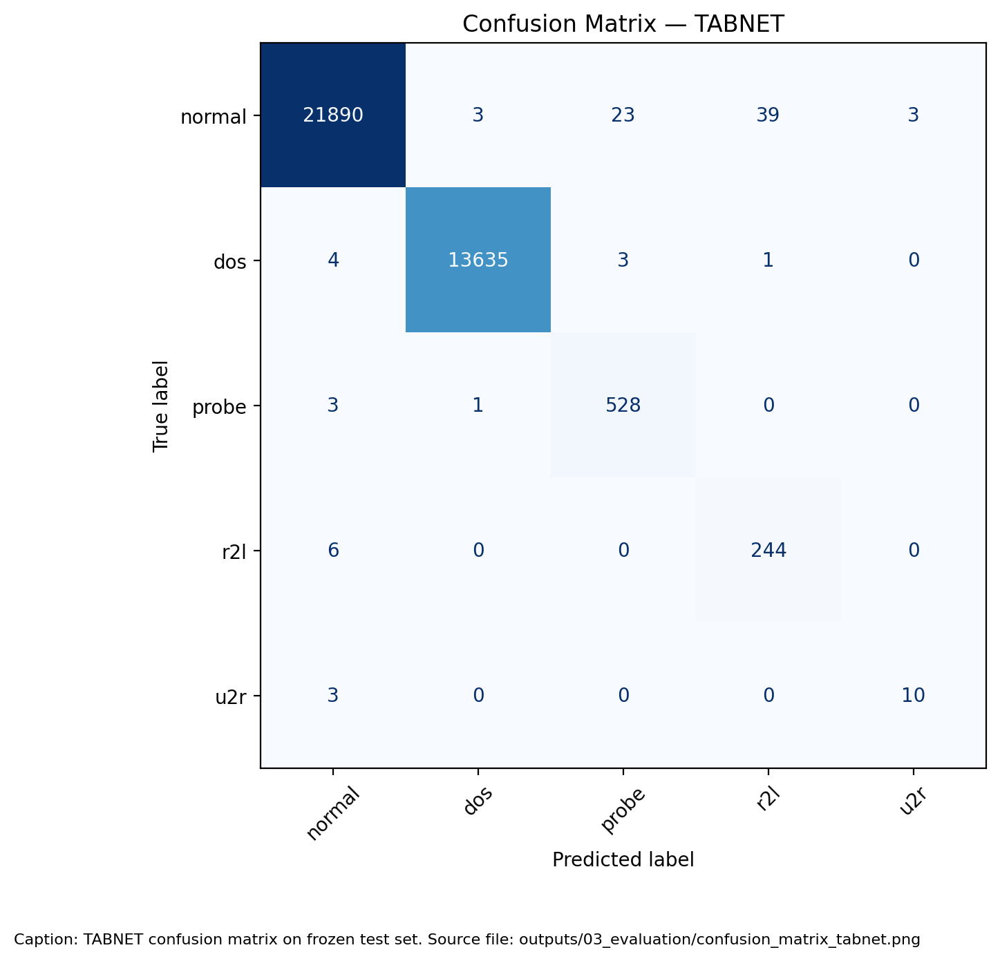
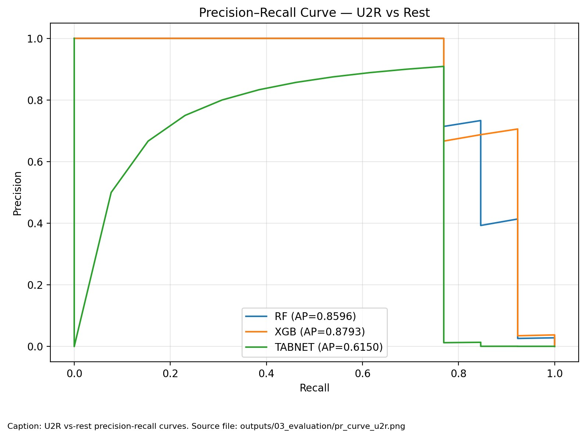
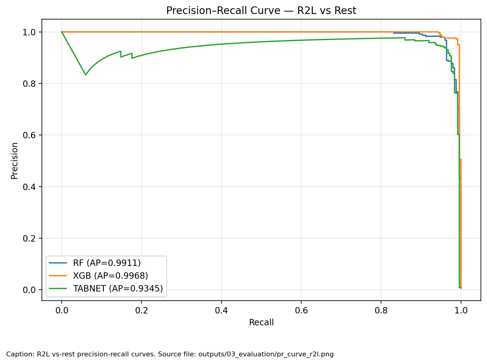
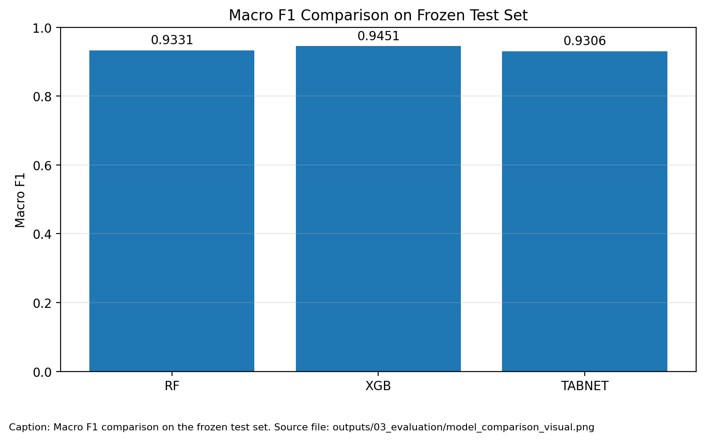
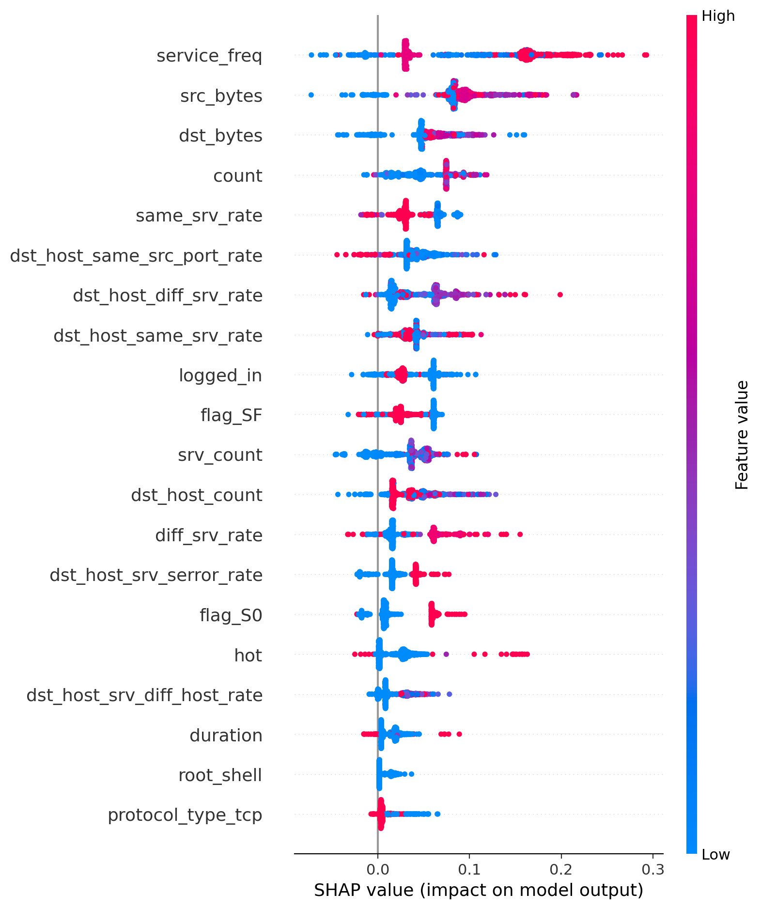
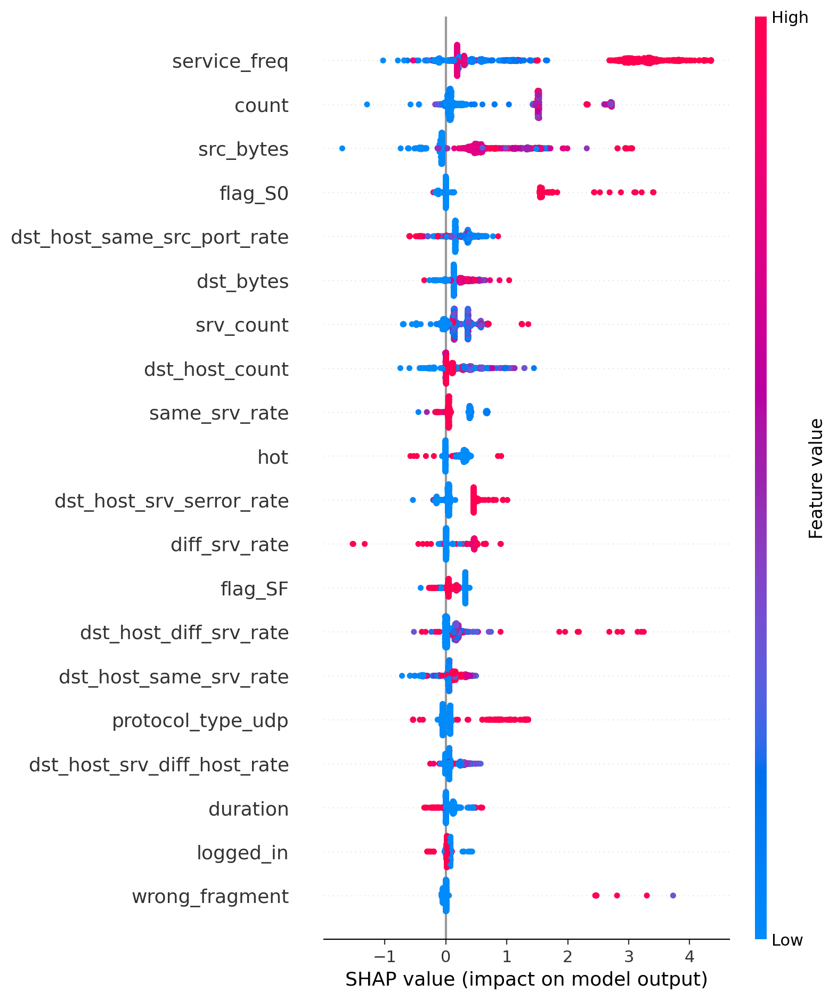
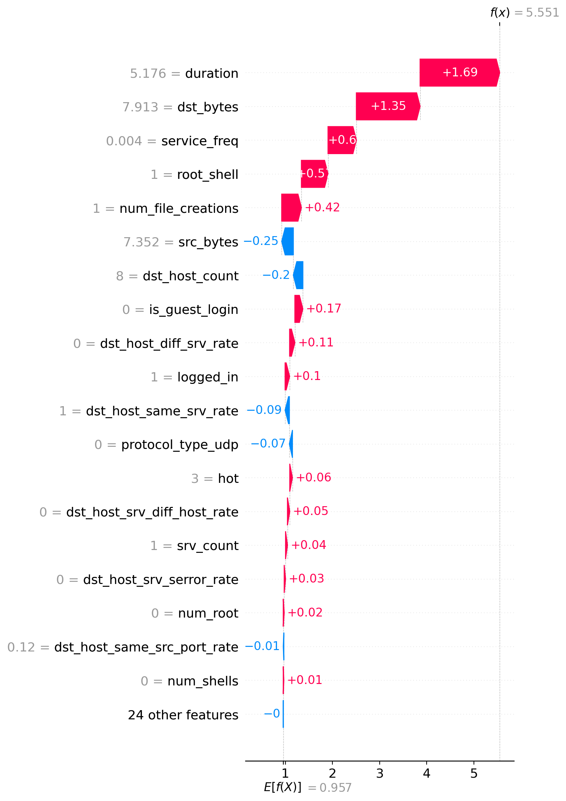
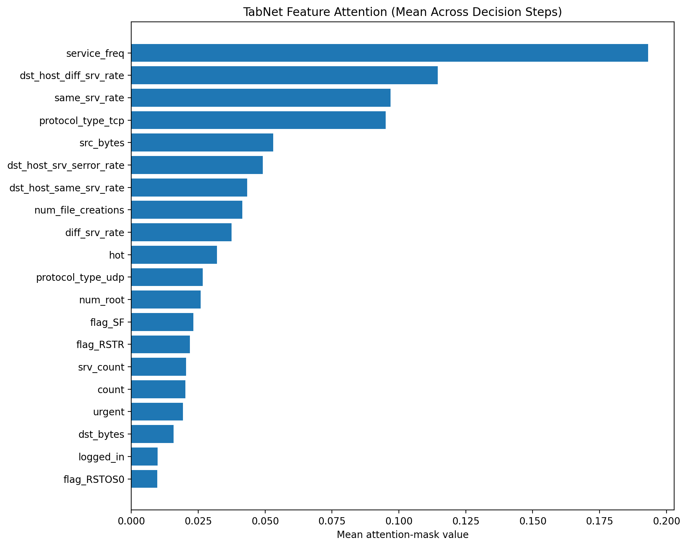

# Network Guardian IDS — A Comparative Study of Bagging, Boosting, and Deep Attention Architectures for Multi-Class Network Intrusion Detection

Kit Dustin, Markie, Amber, Kenneth, and Dwayne

[Full author names and institutional affiliations to be completed]

Corresponding author: [Full name and email to be completed]

OCTOBER 2026

## Abstract

Background. Intrusion detection must distinguish normal connections from attacks while preserving detection of rare categories. Benchmarks support reproducible comparisons but do not establish performance on contemporary operational traffic.

Objective. This study compares Random Forest, XGBoost, and TabNet for five-class network connection classification, emphasizing Macro F1, rare-attack errors, computational observations, and reproducibility.

Methods. The supplied KDD Cup 1999 file contains 494,021 records and 41 predictors. Deduplication retains 145,584 records. A frozen stratified split reserves 36,396 records for testing; transformation and encoding yield 43 inputs. Optimization uses class weighting and Tomek Links within training folds. The tree models use five validation folds and TabNet uses three. Saved models were evaluated without retraining.

Results. Test Macro F1 was 0.933095 for Random Forest, 0.945134 for XGBoost, and 0.930622 for TabNet. XGBoost achieved R2L recall of 0.992000, compared with 0.952000 and 0.976000. All models correctly identified ten of thirteen U2R records and missed the same three. Full-test prediction times were 0.151, 0.126, and 1.091 seconds, respectively. Exported predictions reproduce the reported scores. XGBoost and TabNet validation dispersion metadata represent trial-level variability rather than independent fold variability.

Conclusion. XGBoost is the preferred candidate on this benchmark, with the highest test Macro F1 and R2L recall. Small rare-class support, historical simulated data, preprocessing outside individual folds, unequal search histories, and limited timing provenance constrain interpretation. Sampled explanations are included; deployment verification remains pending. The observed U2R agreement does not prove an intrinsic detection ceiling. Rare-class errors require investigation alongside false alarms, model calibration, and receiving-device artifact verification.

### Keywords

Intrusion Detection; Machine Learning; KDD Cup 1999; Explainable AI; Tabular Deep Learning; Anomaly Detection.

## 1. Introduction

### 1.1 Motivation

Network intrusion detection requires distinguishing legitimate connections from activity that threatens the confidentiality, integrity, or availability of a system. A machine learning classifier approaches this task by learning relationships between connection attributes and labeled outcomes. Network Guardian IDS investigates this approach through a five class classification problem using network connection records. The project compares alternative learning methods and examines whether their errors differ across common and rare attack families.

The benchmark task concerns connection level classification rather than direct inspection of live packet streams. KDD Cup 1999 draws on a simulated network environment associated with the 1998 DARPA intrusion detection evaluation. This origin provides a reproducible research setting but limits the conclusions that can be drawn about current operational traffic (ACM SIGKDD, n.d.-a). The project therefore evaluates a research prototype rather than claiming production readiness.

### 1.2 Problem Statement

The target classes are normal, denial of service, probe, remote to local, and user to root. Denial of service attacks interfere with service availability, probing seeks information about hosts or services, remote to local attacks seek unauthorized access from a remote system, and user to root attacks seek elevated privileges from an existing user context (ACM SIGKDD, n.d.-a). Each record receives one family label; the project does not infer the full attack sequence from that label alone.

Class imbalance is central to the research problem. The prepared training partition contains 65,874 normal connections but only 39 user to root examples. A model can perform well on frequent classes while failing on the rarest category. Accordingly, the comparison emphasizes Macro F1 and class level recall alongside aggregate measures. The operational significance of a missed attack and the burden of a false alarm must both be considered.

The research problem is to assign a connection to normal, DoS, probe, R2L, or U2R using an engineered tabular representation. The class distribution creates unequal statistical support: 13 U2R examples are reserved for testing, while normal traffic has 21,958. Reliable interpretation requires class-level counts and recall, rather than reliance on accuracy alone.

### 1.3 Research Questions

The primary objective is to compare Random Forest, XGBoost, and TabNet using a shared prepared representation and a frozen training and test partition. The study asks how the three approaches differ in overall classification quality, detection of rare attack families, computational requirements, and the explanations available to an analyst. A second objective is to document the preparation decisions and execution difficulties that affect reproducibility.

The comparison is designed around one prepared pipeline. It does not isolate the causal contribution of each transformation because no preprocessing ablation is currently included. Any claim that a particular transformation improves detection will require a separate controlled experiment. Final model recommendations will be based on confirmed training and evaluation artifacts rather than anticipated rankings.

### 1.4 Contributions

The study contributes a comparison of three learning families on a frozen test partition, a reproducible preparation snapshot with explicit feature ordering, and a prototype inference interface. The findings identify limitations in validation reporting and preprocessing isolation. The benchmark supports a comparative recommendation, while broader generalization and operational effectiveness require independent validation.

### 1.5 Paper Organization

Section 2 establishes the background and related work. Section 3 describes the data and preparation, followed by methodology in Section 4 and experimental conditions in Section 5. Section 6 separates available results from pending measurements. Section 7 defines the explainability analysis, Section 8 discusses interpretation and validity, and Section 9 presents conclusions and future work. The appendices retain configuration tables, evaluation inventory, and reproducibility instructions.

## 2. Background and Related Work

### 2.1 Intrusion Detection Systems

Intrusion detection examines system or network activity for indications of security violations. Network-based, host-based, and network behavior analysis systems differ in observation points and available context. This project operates on already extracted connection features and does not implement the full acquisition and response functions of an operational detection system (Scarfone & Mell, 2007).

#### 2.1.1 Signature based Detection

Signature-based methods compare observed activity with representations of known threats. They provide a direct basis for recognizing previously characterized patterns, while coverage depends on the signatures available. The present classifier uses labeled connection records rather than a rule database (Scarfone & Mell, 2007).

#### 2.1.2 Anomaly based Detection

Anomaly-based methods compare activity with an expected behavioral profile. A deviation may indicate an attack or an unusual legitimate event, making false alarms relevant to interpretation. Supervised attack-family classification should not automatically be described as detection of unseen attack types (Scarfone & Mell, 2007).

#### 2.1.3 Hybrid Approaches

Complementary detection methods can be combined within a security architecture (Scarfone & Mell, 2007). In this project, the compared algorithms are separate candidates. No stacked ensemble, fused probability model, or combined signature-and-anomaly detector has been evaluated; the system title alone does not establish such a capability.

### 2.2 Machine Learning for Tabular Classification

The selected methods represent different ways to learn from the same ordered feature vector. Their evaluation shares the target definition and test partition, while retaining differences in validation-fold count and configured optimization budget. These differences prevent the study from being interpreted as a controlled comparison of equal training cost.

#### 2.2.1 Bagging Ensembles

Breiman (2001) describes Random Forest as an ensemble of randomized tree predictors. Random sampling and feature selection produce diverse trees whose predictions are aggregated. Out-of-bag estimates use records omitted from an individual tree bootstrap sample. These estimates provide an internal diagnostic, while the independent test partition remains necessary for the project comparison.

#### 2.2.2 Gradient Boosting

Chen and Guestrin (2016) present XGBoost as a scalable tree boosting system with sparse-data handling and regularized tree learning. Sequential tree construction differs from the aggregation of independently randomized trees. The method motivates a boosting candidate in this study, but its published engineering advantages do not determine its ranking on the prepared intrusion dataset.

#### 2.2.3 Deep Tabular Architectures

Arik and Pfister (2019) introduce TabNet, which uses sequential attention to select features during processing of tabular records. Its architecture supplies feature-selection masks as part of the network computation. A shared input dimension permits comparison with the tree models, but optimization, stopping, and representation choices must still be accounted for.

### 2.3 Explainable AI in Security

#### 2.3.1 SHAP

Lundberg and Lee (2017) define an additive feature-attribution framework that assigns contributions to a particular prediction. In security analysis, such attributions can describe which encoded fields influenced a classifier response. Their interpretation depends on the explained class and reference distribution; they do not establish an attack cause.

#### 2.3.2 Attention based Interpretability

TabNet attention masks describe the features selected by the model at its decision steps (Arik & Pfister, 2019). They address a different question from additive SHAP contributions. This study interprets each output according to its construction and does not treat them as interchangeable quantitative importance scores.

### 2.4 The KDD Cup 1999 Benchmark

#### 2.4.1 Dataset Description

KDD Cup 1999 poses a predictive task distinguishing normal connections from intrusions. Its records derive from a simulated environment associated with the 1998 DARPA evaluation. The supplied file is treated as the project input snapshot; its size and class counts are verified locally rather than assumed to describe every benchmark release (ACM SIGKDD, n.d.-a; Network Guardian IDS Team, 2026a).

#### 2.4.2 Known Limitations

The historical simulated origin limits transfer to present-day traffic. Local profiling also shows extensive duplication and few U2R records. Duplicate removal changes the relative class frequencies, while random stratification evaluates a different condition from time-based transfer or entirely unseen attack families. No contemporary operational detection claim follows from this benchmark alone.

#### 2.4.3 Published Baselines

The official archive identifies the original competition winners and preserves the historical evaluation context (ACM SIGKDD, n.d.-b). Those outcomes are not numerical baselines for the present split. Before comparing a published score, the analysis must establish matching target definitions, duplicate treatment, training and test files, and metric definitions. No literature-derived performance number is presented as a directly comparable baseline in this draft.

## 3. Dataset and Preprocessing

### 3.1 Data Source and Schema

The dataset contains 494,021 connection records, 41 predictor variables, and one attack label. Profiling identified no missing values. Protocol type, service, and connection flag are categorical strings, whereas the remaining 38 variables are numerical. The attack manifest defines 22 attack mappings. The normal category is added explicitly, producing 23 observed labels grouped into five classes. These characteristics correspond to the supplied KDD Cup 1999 connection dataset (Network Guardian IDS Team, 2026a).

**Table 1. Class distribution before and after deduplication and in the frozen split**

| Class | Raw | Prepared | Training | Test |
| --- | --- | --- | --- | --- |
| Normal | 97,278 | 87,832 | 65,874 | 21,958 |
| DoS | 391,458 | 54,571 | 40,928 | 13,643 |
| Probe | 4,107 | 2,130 | 1,598 | 532 |
| R2L | 1,126 | 999 | 749 | 250 |
| U2R | 52 | 52 | 39 | 13 |
| Total | 494,021 | 145,584 | 109,188 | 36,396 |

Source: Notebook 01 execution and data/processed/split_indices.json. Removing 348,437 repeated feature vectors reduced the dataset by approximately 70.5 percent. U2R retained only 52 records across the prepared dataset. The small support means that a single incorrect U2R prediction can noticeably change the reported test recall.

### 3.2 Target Definition

Twenty-two attack names and the explicitly added normal category are mapped to five canonical families. The class manifest controls decoding. Predictor fields contain connection attributes; the original label is excluded from the model input vector. Label spelling and punctuation normalization are handled by the preparation code.

### 3.3 Class Balance and Rare Classes

Before duplicate removal, DoS accounts for 391,458 records compared with 97,278 normal connections. Afterwards normal records number 87,832 and DoS records number 54,571. U2R retains 52 examples across the complete prepared dataset. These counts motivate stratification and equal class weighting in the objective, but do not remove the uncertainty caused by sparse support.

### 3.4 Feature Description

Basic connection attributes describe traffic volume and status. Content attributes summarize activity within a connection, while time based and host based traffic attributes describe related connections. All 41 fields in Table 2 are candidate inputs before feature removal; label is the target, not a predictor. Numerical ranges are observed minima and maxima in the supplied raw file, not validation limits for future network traffic. Categories number three for protocol_type, 66 for service, and 11 for flag in this local file.

**Table 2. Raw feature dictionary with locally observed values**

| Feature name | Type and range | Description | Role |
| --- | --- | --- | --- |
| duration | Numeric; 0 to 58,329 | Connection length in seconds | Retained predictor |
| protocol_type | Category; 3 values | Transport or network protocol | Encoded predictor |
| service | Category; 66 values | Destination service category | Encoded predictor |
| flag | Category; 11 values | Connection status category | Encoded predictor |
| src_bytes | Numeric; 0 to 693,375,640 | Bytes toward destination | Retained predictor |
| dst_bytes | Numeric; 0 to 5,155,468 | Bytes toward source | Retained predictor |
| land | Numeric; 0 to 1 | Same host and port indicator | Retained predictor |
| wrong_fragment | Numeric; 0 to 3 | Invalid fragment count | Retained predictor |
| urgent | Numeric; 0 to 3 | Urgent packet count | Retained predictor |
| hot | Numeric; 0 to 30 | Sensitive activity indicator count | Retained predictor |
| num_failed_logins | Numeric; 0 to 5 | Failed authentication count | Retained predictor |
| logged_in | Numeric; 0 to 1 | Successful authentication indicator | Retained predictor |
| num_compromised | Numeric; 0 to 884 | Compromise indicator count | Removed before encoding |
| root_shell | Numeric; 0 to 1 | Root shell indicator | Retained predictor |
| su_attempted | Numeric; 0 to 2 | Superuser command indicator | Retained predictor |
| num_root | Numeric; 0 to 993 | Root access count | Retained predictor |
| num_file_creations | Numeric; 0 to 28 | File creation count | Retained predictor |
| num_shells | Numeric; 0 to 2 | Shell prompt count | Retained predictor |
| num_access_files | Numeric; 0 to 8 | Access control file operation count | Retained predictor |
| num_outbound_cmds | Numeric; 0 to 0 | Outbound FTP command count | Removed before encoding |
| is_host_login | Numeric; 0 to 0 | Host login indicator | Removed before encoding |
| is_guest_login | Numeric; 0 to 1 | Guest login indicator | Retained predictor |
| count | Numeric; 0 to 511 | Recent same host connections | Retained predictor |
| srv_count | Numeric; 0 to 511 | Recent same service connections | Retained predictor |
| serror_rate | Numeric; 0 to 1 | Same host SYN error fraction | Removed before encoding |
| srv_serror_rate | Numeric; 0 to 1 | Same service SYN error fraction | Removed before encoding |
| rerror_rate | Numeric; 0 to 1 | Same host rejection fraction | Removed before encoding |
| srv_rerror_rate | Numeric; 0 to 1 | Same service rejection fraction | Removed before encoding |
| same_srv_rate | Numeric; 0 to 1 | Same host same service fraction | Retained predictor |
| diff_srv_rate | Numeric; 0 to 1 | Same host other service fraction | Retained predictor |
| srv_diff_host_rate | Numeric; 0 to 1 | Same service other host fraction | Retained predictor |
| dst_host_count | Numeric; 0 to 255 | Host window connection count | Retained predictor |
| dst_host_srv_count | Numeric; 0 to 255 | Host window same service count | Removed before encoding |
| dst_host_same_srv_rate | Numeric; 0 to 1 | Host window same service fraction | Retained predictor |
| dst_host_diff_srv_rate | Numeric; 0 to 1 | Host window other service fraction | Retained predictor |
| dst_host_same_src_port_rate | Numeric; 0 to 1 | Host window same source port fraction | Retained predictor |
| dst_host_srv_diff_host_rate | Numeric; 0 to 1 | Service window other host fraction | Retained predictor |
| dst_host_serror_rate | Numeric; 0 to 1 | Host window SYN error fraction | Removed before encoding |
| dst_host_srv_serror_rate | Numeric; 0 to 1 | Host service SYN error fraction | Retained predictor |
| dst_host_rerror_rate | Numeric; 0 to 1 | Host window rejection fraction | Removed before encoding |
| dst_host_srv_rerror_rate | Numeric; 0 to 1 | Host service rejection fraction | Retained predictor |

Source: data/raw/kddcup.names.txt, local profiling of data/raw/kddcup.csv, and the benchmark feature descriptions. The repository spelling is_host_login is retained. The indicators and counts are stored numerically even where their semantic role is categorical or binary.

### 3.5 Cleaning and Duplicate Removal

The pipeline parses the raw feature manifest, appends the implicit label column, and maps attack names to their canonical families. Normal is injected into the mapping because it is absent from the attack manifest. Duplicate removal compares the 41 input features rather than the label. When identical feature vectors have different labels, the first record is retained. This policy reduces repeated examples across the subsequent split but also requires scrutiny of any conflicting labels that may be discarded.

### 3.6 Constant and Correlated Feature Removal

Two constant variables, num_outbound_cmds and is_host_login, were removed. Absolute Pearson correlations were then computed among the numerical variables. For pairs with correlation greater than 0.90, the later variable in the original column order was removed. The excluded correlated variables were dst_host_rerror_rate, dst_host_serror_rate, dst_host_srv_count, num_compromised, rerror_rate, serror_rate, srv_rerror_rate, and srv_serror_rate. The resulting representation contained 28 numerical and three categorical variables before encoding.

Constant detection and correlation pruning preceded the training and test split. These transformations therefore used the complete feature pool, including records subsequently assigned to the test partition. Although target labels were not used for these selection steps, this design limits claims of fully isolated preprocessing. Future experiments should estimate data-dependent feature selection within training folds.

### 3.7 Transformation and Categorical Encoding

The duration, src_bytes, and dst_bytes fields receive log(1 + x) transformations to compress large numerical ranges while retaining zero values. Service is frequency encoded using the training partition, with unseen services mapped to zero. Protocol and flag are one hot encoded using training fitted categories; unknown values produce zeros for the corresponding block. The final representation contains 28 numerical features, one service frequency, three protocol indicators, and 11 flag indicators, totaling 43 ordered inputs.

### 3.8 Partitioning and Scaling

A stratified 75 percent training and 25 percent test split uses random state 42. The resulting arrays contain 109,188 training rows and 36,396 test rows. Features are float64 and labels are fixed width Unicode. A StandardScaler is fit on the training partition and saved, but the TabNet training functions do not apply it. The updated inference bridge passes raw engineered features to TabNet to match its training representation; a real TabNet API request remains unverified. Tree models also use the unscaled engineered representation. The saved JSON manifests specify the input order, class order, and frozen split, while saved encoders provide the inference transformation.

The categorical encoders and scaler were fitted to the complete training partition rather than refitted within each cross-validation fold. Validation-fold covariates therefore contributed to preprocessing statistics. The held-out test partition was excluded from their fitting. Cross-validation estimates should be interpreted with this qualification; fold-specific preprocessing would provide a stricter assessment during model selection.

### 3.9 Imbalance Handling and Artifact Verification

Tomek Links is applied to each fold training subset, followed by class weighting. Validation and test records are not resampled. Frozen arrays are accompanied by feature and class manifests, fitted encoders, a saved scaler, and split indices. Re-execution verified the expected array shapes, Unicode label representation, and four reference hashes (Network Guardian IDS Team, 2026a, 2026e).

## 4. Methodology

### 4.1 Task Definition and Formal Notation

Let D = {(x_i, y_i)} contain the prepared observations, where x_i is a vector of 43 ordered inputs and y_i belongs to C = {normal, dos, probe, r2l, u2r}. A model f_theta maps x_i to five class probabilities; the predicted family is the class with the highest probability. The stored model class identifiers determine probability-column decoding. A probability percentage is a classifier output and has not been established as a calibrated operational risk estimate.

For class c, precision P_c = TP_c / (TP_c + FP_c), recall R_c = TP_c / (TP_c + FN_c), and F1_c = 2 P_c R_c / (P_c + R_c). Macro F1 = (1/5) sum_c F1_c. Reported class support is the number of true observations for that family. The evaluation must state its treatment of zero denominators and preserve the complete class order.

### 4.2 Candidate Models

#### 4.2.1 Random Forest

Random Forest combines decision trees trained with random sampling of records and candidate split features. Aggregation provides a bagging baseline for tabular classification (Breiman, 2001). Bootstrap sampling, out-of-bag estimation, and class weighting are included in the experimental configuration. These mechanisms support comparison without guaranteeing reliable detection of rare attacks.

#### 4.2.2 XGBoost

XGBoost is a regularized gradient tree boosting framework that builds an additive ensemble through sequential optimization (Chen & Guestrin, 2016). The implementation assigns class weighted sample weights and evaluates candidate configurations using five fold stratified validation. The search budget is 30 trials and the objective is the mean Macro F1 across validation folds. Validation based early stopping uses a patience of 20 rounds.

#### 4.2.3 TabNet

TabNet uses sequential attention for feature selection in tabular classification (Arik & Pfister, 2019). Trial 16 selected n_d = 24, n_a = 32, six decision steps, entmax masks, two independent and one shared transformer, batch size 512, and virtual batch size 256. The remaining selected values and all search ranges are retained in Appendix A.

All models use the same 43 encoded predictors, target family, random state 42, 109,188 training records before resampling, and 36,396 reserved test records. The metadata table distinguishes configurations, actual study history, and measured results.

**Table 3. Experimental model metadata**

| Metadata | Random Forest | XGBoost | TabNet |
| --- | --- | --- | --- |
| Algorithm | Tree bagging | Gradient boosting | Sequential attention |
| Target | family, five classes | family, five classes | family, five classes |
| Input features | 43 | 43 | 43 |
| Features used | All encoded predictors | All encoded predictors | All encoded predictors |
| Training rows | 109,188 | 109,188 | 109,188 |
| Test rows | 36,396 | 36,396 | 36,396 |
| Random state | 42 | 42 | 42 |
| Validation folds | 5 | 5 | 3 |
| Best trial | 17 | 81 | 16 |
| Configured trial budget | 20 | 30 per invocation | 20 |
| Recorded trials | 20 | 90 | 20 |
| Main measure | Macro F1 | Macro F1 | Macro F1 |
| Test Macro F1 | 0.933095 | 0.945134 | 0.930622 |
| Full-test prediction (s) | 0.151 | 0.126 | 1.091 |
| Training wall time | Not recorded consistently | About 1 h 55 min, reported | Not recorded consistently |
| Model artifact | rf_baseline.joblib | xgb_optuna.joblib | tabnet_best.zip |

Sources: models/*.meta.json, outputs/02_training/optuna_*_trials.csv, and the execution/evaluation reports. The XGBoost trial log contains 90 records, including 78 completed and 12 pruned, whereas 30 is the configured per-invocation budget. The sidecar alone does not describe the accumulated search history (Network Guardian IDS Team, 2026h, 2026i).

### 4.3 Hyperparameter Optimization

Optuna searches bounded model-specific spaces using validation Macro F1 (Akiba et al., 2019). The configured trial budgets are 20 for Random Forest, 30 for XGBoost, and 20 for TabNet. Search ranges and available selected configurations appear in Appendix A. These budgets cannot be used as measured completed-trial counts, and optimization cost is not equalized across architectures.

### 4.4 Cross Validation and Final Refit

The implementations use a shared random state and persist optimization studies for traceability. Optuna selects configurations according to validation Macro F1; pruning can stop unpromising trials before they consume the full budget (Akiba et al., 2019). Tomek Links removes selected boundary examples from fold training data, while validation subsets are not resampled. Class weights increase the contribution of less frequent classes. The final test partition is reserved for Notebook 03 and is not passed to model tuning functions.

Macro F1 is the arithmetic mean of the five class F1 values. For each class, precision measures how many predicted members are correct, recall measures how many actual members are recovered, and F1 balances precision and recall. Equal class weighting prevents the most frequent category from dominating the summary. Per class support and confusion matrices remain necessary because the same Macro F1 can arise from different error patterns.

Each trial was assessed with five stratified folds. Tomek Links and class weighting were restricted to the fold training subset; validation predictions were used to calculate Macro F1. After selection, the Random Forest was refitted on the cleaned training pool, with the test partition reserved for subsequent evaluation (Network Guardian IDS Team, 2026b, 2026f).

The XGBoost study uses a configured budget of 30 trials per invocation. Its saved history contains 90 records: 78 completed and 12 pruned. Trial 81 was selected with mean validation Macro F1 of 0.950842. Five stratified folds, class-weighted fold training, Tomek Links, and validation-based early stopping with patience 20 were retained. Final refitting disables early stopping because no eval_set is supplied; the saved test partition is not used for refit (Network Guardian IDS Team, 2026i).

TabNet uses 20 configured Optuna trials and three stratified validation folds. With 39 U2R training records, three folds place approximately 13 examples in each validation fold, compared with roughly seven or eight under five folds. This increases support per fold but does not establish that the rare class estimate is stable. The different fold counts must remain visible when comparing the algorithms. Tomek Links is restricted to fold training subsets. The final refit includes an internal 10 percent validation subset for early stopping rather than unrestricted training on the entire pool.

### 4.5 Evaluation and Error Analysis

The saved RF, XGBoost, and TabNet artifacts were evaluated once on the frozen 36,396-row test partition without retraining. Macro F1, weighted F1, accuracy, per-class metrics, confusion matrices, and rare-class precision-recall curves were exported. Counts in the stored prediction rows reproduce the reported class F1 and Macro F1 values. Attack-family misses are distinguished from attacks labeled normal; class support accompanies each result (Network Guardian IDS Team, 2026h).

### 4.6 Inference Architecture

The backend implements POST /api/analyze on localhost port 5000. It validates the 31 raw categorical and numerical request fields before starting the repository virtual environment Python interpreter. The bridge applies logarithmic transformations and the frozen encoders, reconstructs the 43 feature columns in their stored order, checks model metadata, and decodes probability columns using the model class identifiers. This avoids dependence on JSON key order and prevents incorrect family decoding when a classifier uses a different probability column order.

Successful requests return a family label, confidence percentage, threat indicator, and model identifier. Invalid requests return HTTP 400. Missing artifacts, bridge failures, invalid model outputs, and timeouts return HTTP 500 with a structured error. The frontend must treat an error envelope as a failed request; its default normal field is not a prediction. The service uses bounded request and response sizes and a per-request timeout.

Functional verification passed 10 Node API tests and three Python bridge tests. A real HTTP inference request using the RF artifact returned a valid response, and reversing the raw JSON key order preserved that response. These checks establish tested interface behavior, not classifier accuracy. No training or test-set evaluation was performed during backend verification (Network Guardian IDS Team, 2026g).

The updated API contract and bridge pass raw engineered features to TabNet, matching the saved model's training representation. Repository tests cover routing with fixtures, but this integration did not verify a real TabNet API request using the model artifact. XGBoost receiving-device verification also remains pending. Offline test evaluation does not establish live-route readiness (Network Guardian IDS Team, 2026g, 2026h, 2026k).

## 5. Experiments

### 5.1 Experimental Setup

The experiments use the prepared arrays with a fixed partition and random state 42. Python 3.11.9 was verified during setup. The recorded software pins include NumPy 1.26.0, pandas 2.1.1, scikit-learn 1.3.1, XGBoost 2.0.0, PyTorch 2.1.0, pytorch-tabnet 4.1.0, Optuna 3.4.0, imbalanced-learn 0.11.0, and SHAP 0.44.0. These environment specifications support reproduction but do not imply identical numerical behavior on every device (Network Guardian IDS Team, 2026a, 2026e).

### 5.2 Hardware and Runtime

TabNet specifies CPU execution. The reported full-test prediction times are 0.151 seconds for RF, 0.126 for XGBoost, and 1.091 for TabNet. These measurements concern one batch prediction run and exclude HTTP behavior. XGBoost training wall time is reported as approximately 1 hour 55 minutes. Complete matched hardware, repeated timings, and equivalent optimization budgets are unavailable, limiting computational comparisons (Network Guardian IDS Team, 2026h, 2026i).

### 5.3 Training Protocol

The tree models use five stratified folds, while TabNet uses three. The reduced TabNet fold count increases the number of rare-class validation examples per fold. XGBoost uses early-stopping patience 20; TabNet uses at most 30 epochs with patience 10 and an internal 10 percent validation subset during final refit. The categorical encoders are not refitted within each fold, which qualifies the cross-validation estimates.

### 5.4 Reproducibility

The repository preserves transformation artifacts, manifests, optimization studies, configuration records, and source reports. Duplicate notebook export logic initially replaced Unicode labels with object arrays, preventing safe NumPy loading. Removing the duplicate cell and re-executing the preparation notebook restored the intended representation and hash checks. Reproducibility therefore depends on verifying final artifacts after the entire notebook sequence, not only on successful execution of an intermediate cell (Network Guardian IDS Team, 2026a, 2026e).

## 6. Results

### 6.1 Preparation Findings

Preparation retained 145,584 feature vectors and produced 43 ordered inputs. These are data-preparation findings. The following validation and held-out metrics describe model performance under separate experimental conditions.

### 6.2 Validation Objectives

The selected study objective is the mean validation Macro F1. Five folds were used for the tree models and three for TabNet. Table entries preserve the configured and recorded trial counts separately; repeated study execution can accumulate additional trial indices.

**Table 4. Selected validation objectives and optimization records**

| Model | CV mean | Folds | Best trial | Recorded trials |
| --- | --- | --- | --- | --- |
| Random Forest | 0.950540 | 5 | 17 | 20 (20 complete, 0 pruned) |
| XGBoost | 0.950842 | 5 | 81 | 90 (78 complete, 12 pruned) |
| TabNet | 0.921225 | 3 | 16 | 20 (15 complete, 5 pruned) |

Source: outputs/02_training/model_comparison.csv, model metadata, and optuna_*_trials.csv. Random Forest has independently recorded best-trial fold SD of 0.021178. XGBoost and TabNet metadata values of 0.025954 and 0.019250 come from _safe_cv_std, which computes dispersion across recorded trial values, including non-null pruned values. They are not fold-level standard deviations and are not displayed as comparable CV error bars.

The XGBoost and TabNet *_cv_scores.csv files contain cumulative fold means reported to Optuna. A cumulative mean after successive folds is not an independent fold score. The final cumulative value agrees with the selected objective, but directly taking dispersion across these exports would answer the wrong question. Confirmed independent fold reporting remains a documentation dependency (Network Guardian IDS Team, 2026b, 2026i).

### 6.3 Held Out Test Results

The saved models were evaluated on 36,396 frozen test connections with 43 features and the canonical class order. The exported prediction rows reproduce the reported per-class F1 and Macro F1 values. No training, tuning, or resplitting was performed for this manuscript integration. XGBoost achieved test Macro F1 of 0.945134, followed by Random Forest at 0.933095 and TabNet at 0.930622. (Network Guardian IDS Team, 2026h)

**Table 5. Frozen test-set comparison**

| Measure | Random Forest | XGBoost | TabNet |
| --- | --- | --- | --- |
| Test Macro F1 | 0.933095 | 0.945134 | 0.930622 |
| Test weighted F1 | 0.998905 | 0.998961 | 0.997602 |
| Test accuracy | 0.998901 | 0.998956 | 0.997555 |
| Normal recall | 0.999408 | 0.999044 | 0.996903 |
| DOS recall | 0.999707 | 0.999560 | 0.999414 |
| Probe recall | 0.984962 | 0.988722 | 0.992481 |
| R2L recall | 0.952000 | 0.992000 | 0.976000 |
| U2R recall | 0.769231 | 0.769231 | 0.769231 |
| Full-test prediction time (s) | 0.151 | 0.126 | 1.091 |

Sources: outputs/03_evaluation/test_set_evaluation.json and per_class_metrics.csv; weighted F1 and prediction times are recorded in the evaluation report. Timing covers prediction of the full test matrix in that run, not HTTP response time, model loading, or a repeated deployment benchmark. Complete hardware and repetition details are not supplied (Network Guardian IDS Team, 2026h).

**Table 6. Class precision and recall on the frozen test set**

| Class | Support | RF P | RF R | XGB P | XGB R | Tab P | Tab R |
| --- | --- | --- | --- | --- | --- | --- | --- |
| Normal | 21958 | 0.998998 | 0.999408 | 0.999544 | 0.999044 | 0.999270 | 0.996903 |
| Dos | 13643 | 0.999780 | 0.999707 | 0.999707 | 0.999560 | 0.999707 | 0.999414 |
| Probe | 532 | 0.992424 | 0.984962 | 0.985019 | 0.988722 | 0.953069 | 0.992481 |
| R2L | 250 | 0.975410 | 0.952000 | 0.950192 | 0.992000 | 0.859155 | 0.976000 |
| U2R | 13 | 0.666667 | 0.769231 | 0.769231 | 0.769231 | 0.769231 | 0.769231 |

Source: outputs/03_evaluation/per_class_metrics.csv. P denotes precision and R recall. The normalized CSV adds support_fraction while retaining metrics on the 0–1 scale; its project-wide schema is not yet confirmed. The unambiguous standard metrics are used here.

### 6.4 Error Patterns and Generalization

All three models missed the same three U2R records, identified at zero-based exported-row positions 20207, 30364, and 32453. RF and TabNet labeled all three normal. XGBoost labeled the first R2L and the other two normal. Equal family recall therefore reflects shared missed records, but the operational threat indicators differ for one case. This agreement does not establish a permanent detection ceiling or prove that the features are intrinsically inseparable.

**Table 7. Attack-family misses and operational detection errors**

| Model | U2R misses | R2L misses | Attack as normal | Normal as attack |
| --- | --- | --- | --- | --- |
| Random Forest | 3 | 12 | 22 | 13 |
| XGBoost | 3 | 2 | 10 | 21 |
| TabNet | 3 | 6 | 16 | 68 |

Source: outputs/03_evaluation/test_predictions.csv; counts reconstructed without refitting. An attack-family miss includes misclassification into another attack family. It differs from an undetected attack classified as normal. Normal-as-attack errors correspond to false alarms under the binary threat indicator.

XGBoost correctly classified 248 of 250 R2L records, compared with 238 for Random Forest and 244 for TabNet. Its R2L precision was 0.950192, below Random Forest at 0.975410 but above TabNet at 0.859155. This tradeoff prevents the higher R2L recall from being interpreted as superiority on every error measure. One U2R test error changes recall by approximately 7.69 percentage points; no significance test or operational error-cost model has been established.

Cross-validation objectives, in-sample performance, and test performance measure different conditions. The following table reports CV minus test Macro F1; it is not a training-minus-test or training-minus-validation gap.

**Table 8. Validation objective and held-out test difference**

| Model | CV mean | Test Macro F1 | CV minus test |
| --- | --- | --- | --- |
| Random Forest | 0.950540 | 0.933095 | 0.017445 |
| XGBoost | 0.950842 | 0.945134 | 0.005708 |
| TabNet | 0.921225 | 0.930622 | -0.009397 |

Sources: outputs/02_training/model_comparison.csv and outputs/03_evaluation/test_set_evaluation.json. The RF and XGBoost differences are 0.017445 and 0.005708; TabNet test Macro F1 exceeds its CV mean by 0.009397. Unequal fold support and one random test partition qualify interpretation; these differences alone cannot establish absence of overfitting.

A separate TabNet verification report records in-sample Macro F1 of 0.962640. Its difference from the recorded CV mean is 0.041415 and from test Macro F1 is approximately 0.032018. These comparisons are attributed to the report and are not newly generated training evaluations. Comparable full-training Macro F1 for RF and XGBoost remains unavailable (Network Guardian IDS Team, 2026c, 2026h).

### 6.5 Evaluation Figures

The following figures were exported from the completed evaluation. The class-distribution plot uses frozen split counts; the remaining plots describe saved-model predictions on the test partition. They retain the original axes and class ordering. Sampled SHAP summaries, a local explanation, and TabNet attention analysis are presented below.

**Figure 1. Class distribution in the frozen training and test partitions**

Source: outputs/03_evaluation/class_distribution.png.

**Figure 2. Random Forest confusion matrix on the frozen test set**

Source: outputs/03_evaluation/confusion_matrix_rf.png.

**Figure 3. XGBoost confusion matrix on the frozen test set**

Source: outputs/03_evaluation/confusion_matrix_xgb.png.

**Figure 4. TabNet confusion matrix on the frozen test set**

Source: outputs/03_evaluation/confusion_matrix_tabnet.png.

**Figure 5. U2R precision recall curves for the three saved models**

Source: outputs/03_evaluation/pr_curve_u2r.png.

**Figure 6. R2L precision recall curves for the three saved models**

Source: outputs/03_evaluation/pr_curve_r2l.png.

**Figure 7. Model comparison from the frozen test evaluation**

Source: outputs/03_evaluation/model_comparison_visual.png.

Precision-recall curves describe probability ranking across thresholds; they do not establish calibration or a deployed alert threshold. The comparison graphic retains its source labels; any cross-validation dispersion shown must be interpreted under the reporting qualifications given in the validation table. (Network Guardian IDS Team, 2026h)

## 7. Explainability Analysis

### 7.1 Global Tree Explanations

TreeExplainer was applied to 1,000 sampled frozen-test records using random seed 42. Each observation explains its own predicted class; the combined summaries therefore mix output classes. The plots display the 20 leading features. Positive contributions concern the selected class output for that observation, not a common attack-versus-normal score. Absolute scales are not directly comparable between RF and XGBoost (Network Guardian IDS Team, 2026l).

**Figure 8. Random Forest predicted-class SHAP summary on 1,000 test records**

Source: outputs/03_evaluation/shap_summary_rf.png.

The RF summary ranks service_freq, src_bytes, and dst_bytes highest, followed by count. These fields describe service prevalence and traffic volume in the engineered representation. Because the explained class changes between records, a positive contribution cannot be read as a universal increase in attack probability. The figure summarizes the sampled population rather than establishing rare-class feature effects.

**Figure 9. XGBoost predicted-class SHAP summary on 1,000 test records**

Source: outputs/03_evaluation/shap_summary_xgb.png.

The XGBoost summary also ranks service_freq first, followed by count and src_bytes. flag_S0 and host statistics contribute to the displayed ordering. Agreement on some leading fields indicates shared use of the prepared representation, not proof that a field causes an intrusion or that the models use identical decision rules. Different model-output units qualify comparisons of SHAP magnitudes.

### 7.2 Local U2R Explanation

**Figure 10. XGBoost U2R explanation for test row 29522**

Source: outputs/03_evaluation/shap_local_example.png.

The local example is a correctly classified U2R record selected for the highest recorded XGBoost U2R confidence among correct candidates. The saved probability is approximately 0.999486. The displayed class-output score is 5.551 relative to a baseline of 0.957; those waterfall values are not probabilities. Duration and dst_bytes show positive contributions of approximately 1.69 and 1.35, while root_shell and num_file_creations also contribute positively. Duration and byte values are log-transformed model inputs, not raw seconds or byte counts (Network Guardian IDS Team, 2026l).

This selected success case cannot explain the three missed U2R records or establish typical U2R behavior. Inspection of failed cases and additional rare-class data remains necessary. Some source waterfall annotations are abbreviated or truncated; the interpretation uses clearly legible values and does not reconstruct missing labels.

### 7.3 TabNet Feature Attention

**Figure 11. TabNet attention averaged over decision steps and 1,000 test records**

Source: outputs/03_evaluation/tabnet_attention_mask.png.

The attention plot averages feature-selection masks across decision steps and a separately drawn 1,000-record test sample. Its leading fields are service_freq, dst_host_diff_srv_rate, same_srv_rate, and protocol_type_tcp. This aggregate describes how the saved model allocates feature selection; it removes variation between individual records and steps. The TabNet sample is drawn after the tree sample from the same seeded generator, so the analysis does not assume identical sampled records.

### 7.4 Interpretive Limits

SHAP contributions and attention-mask averages answer different questions and are not interchangeable importance scores. Predicted-class pooling, finite samples, and selection of a high-confidence correct local example limit conclusions about rare failures. These descriptive outputs provide no causal proof, calibrated risk estimate, preprocessing ablation, or evidence that the shared U2R misses are unavoidable. These offline explanations do not establish live-route readiness for TabNet or XGBoost.

## 8. Discussion

### 8.1 Key Findings

XGBoost achieved test Macro F1 of 0.945134, followed by Random Forest at 0.933095 and TabNet at 0.930622. XGBoost also achieved the highest R2L recall, while all three models missed the same three U2R examples. Its advantage on this test partition does not establish significance or superiority on every error measure. (Network Guardian IDS Team, 2026h)

Random Forest fold SD is 0.021178 and satisfies the revised 0.025 acceptance threshold. The post-run threshold adjustment is disclosed. XGBoost and TabNet metadata dispersions are trial-level quantities; their cumulative-fold exports require different interpretation from independent fold scores.

### 8.2 Comparison With Published Baselines

The source literature motivates the choice of bagging, boosting, and attention models. It does not supply a verified performance ranking for this exact data treatment and split. A defensible comparison with prior studies requires matching duplicate handling, family mapping, evaluation partition, and metric averaging. This manuscript therefore reports no claim of improvement over a published numerical baseline.

### 8.3 Limitations

The historical simulated benchmark, only 13 U2R test records, preprocessing outside individual validation folds, and unequal optimization budgets limit generalization. Comparable training metrics and complete runtime provenance remain pending. Explanations use sampled test records and one selected success case. A single random test partition and 90 recorded XGBoost trials versus 20 for each other model further qualify the comparison. The normalized-metrics schema remains provisional; standard per-class metrics are used.

### 8.4 Threats to Validity

Internal validity is qualified by constant and correlation-based feature selection before splitting, and by encoders fitted to the full training pool rather than within each validation fold. Statistical conclusion validity is limited by 13 U2R test records, unequal validation-fold counts, and the distinction between cumulative Optuna intermediate means and independent fold results. External validity is limited by the benchmark age and simulated origin. Construct validity requires separating attack-family accuracy from unknown-attack detection, calibrated risk, and causal explanation.

### 8.5 Deployment Considerations

XGBoost is the preferred candidate for this benchmark, with test Macro F1 of 0.945134, R2L recall of 0.992000, and recorded batch prediction time of 0.126 seconds. Its Macro F1 advantage over RF is 0.012039 and over TabNet 0.014512. No statistical significance or production-readiness claim is established.

All models tie on U2R recall. RF has fewer normal false alarms, so the recommendation depends on error tradeoffs. Independent validation, calibration, and real API checks for XGBoost and TabNet remain deployment requirements.

## 9. Conclusion and Future Work

The completed frozen-test evaluation identifies XGBoost as the preferred candidate for this benchmark, with Macro F1 of 0.945134 and R2L recall of 0.992000. RF and TabNet scored 0.933095 and 0.930622. All three correctly identified 10 of 13 U2R records and missed the same three, leaving a shared error pattern that warrants further investigation.

Future work should explain missed attacks, correct independent-fold reporting, record comparable training metrics and runtime provenance, and verify the receiving-device inference paths. Preprocessing fitted within folds, controlled ablations, and newer traffic are required to extend the findings beyond this historical benchmark. The test partition must remain excluded from additional tuning.

## Acknowledgments

The authors acknowledge the maintainers of the KDD Cup 1999 benchmark and the open-source software used to implement the study. Individual funding, institutional support, and contributor details will be included only after confirmation.

## References

ACM SIGKDD. (n.d.-a). KDD Cup 1999 computer network intrusion detection. https://www.kdd.org/kdd-cup/view/kdd-cup-1999/Tasks

ACM SIGKDD. (n.d.-b). KDD Cup 1999 results. https://www.kdd.org/kdd-cup/view/kdd-cup-1999/Results

Akiba, T., Sano, S., Yanase, T., Ohta, T., & Koyama, M. (2019). Optuna: A next-generation hyperparameter optimization framework [Preprint]. arXiv. https://arxiv.org/abs/1907.10902

Arik, S. O., & Pfister, T. (2019). TabNet: Attentive interpretable tabular learning [Preprint]. arXiv. https://arxiv.org/abs/1908.07442

Breiman, L. (2001). Random forests. Machine Learning, 45, 5-32. https://doi.org/10.1023/A:1010933404324

Chen, T., & Guestrin, C. (2016). XGBoost: A scalable tree boosting system. Proceedings of the 22nd ACM SIGKDD International Conference on Knowledge Discovery and Data Mining, 785-794. https://doi.org/10.1145/2939672.2939785

Lundberg, S. M., & Lee, S.-I. (2017). A unified approach to interpreting model predictions [Preprint]. arXiv. https://arxiv.org/abs/1705.07874

Network Guardian IDS Team. (2026a). Environment and data preparation reports and reproducible artifacts [Project documentation]. docs/reports/role-1-phase-1-kit-environment-setup.md; docs/reports/role-1-phase-2-kit-data-preparation.md; notebooks/01_EDA_and_Data_Prep.ipynb; data/processed/split_indices.json; data/processed/feature_names.json.

Network Guardian IDS Team. (2026b). Model architecture and execution specifications [Project documentation]. src/models.py; docs/contracts/role-3-rf-architecture-spec.md; docs/contracts/role-4-training-execution-spec.md; docs/contracts/role-5-training-execution-spec.md.

Network Guardian IDS Team. (2026c). TabNet execution and artifact verification [Unpublished research record]. docs/reports/role-5-tabnet-training-verification-report.md; outputs/02_training/optuna_tabnet_trials.csv; outputs/02_training/tabnet_cv_scores.csv.

Network Guardian IDS Team. (2026d). Frontend scaffold and API data contract [Project documentation]. docs/reports/role-3-phase-1-amber-frontend-scaffold.md; docs/contracts/api_data_contract.md.

Network Guardian IDS Team. (2026e). Role 2 documentation and setup verification [Project documentation]. docs/reports/role-2-phase-1-markie-documentation-scaffolding.md; docs/reports/discovery_log.md.

Network Guardian IDS Team. (2026f). Random Forest configuration and validation statistics [Unpublished research record]. models/rf_baseline.meta.json; docs/reports/role-3-phase-2-amber-rf-baseline.md.

Network Guardian IDS Team. (2026g). Backend inference implementation and functional verification [Unpublished research record]. docs/reports/role-2-phase-2-markie-backend-bridge.md; server/server.js; server/predict_bridge.py; server/validate.js; server/tests.

Network Guardian IDS Team. (2026h). Frozen test evaluation and saved prediction outputs [Research record]. docs/reports/role-5-phase-3-dwayne-evaluation-suite.md; outputs/03_evaluation/test_set_evaluation.json; outputs/03_evaluation/per_class_metrics.csv; outputs/03_evaluation/test_predictions.csv; outputs/03_evaluation/*.png.

Network Guardian IDS Team. (2026i). XGBoost execution and validation reporting [Research record]. docs/reports/role-4-phase-2-kit-xgboost-execution.md; docs/handoffs/xgboost.md; outputs/02_training/optuna_xgb_trials.csv; src/models.py.

Network Guardian IDS Team. (2026j). Random Forest acceptance threshold decision [Project record]. docs/decision/decision_rf_cv_std_threshold_20261013.md.

Network Guardian IDS Team. (2026k). Frontend connection to the live backend [Project record]. docs/reports/role-3-phase-3-amber-frontend-backend-integration.md; client/src/lib/data.ts.

Network Guardian IDS Team. (2026l). Sampled model explanations and feature attention [Research record]. docs/reports/role-5-phase-4-dwayne-explainability.md; src/explainability.py; outputs/03_evaluation/shap_summary_rf.png; shap_summary_xgb.png; shap_local_example.png; tabnet_attention_mask.png. Repository snapshot 7108f414c049ca265bdd6b305e979abcd7a5c614.

Scarfone, K., & Mell, P. (2007). Guide to intrusion detection and prevention systems (IDPS) (NIST Special Publication 800-94). National Institute of Standards and Technology. https://doi.org/10.6028/NIST.SP.800-94

UCI KDD Archive. (1999). KDD Cup 1999 data. https://kdd.ics.uci.edu/databases/kddcup99/kddcup99

### AI Tool Disclosure

OpenAI Codex was used to assist with environment setup, source review, manuscript drafting and formatting, preparation-artifact verification, and backend implementation and functional testing. ChatGPT was also used for troubleshooting and interpretation of execution errors. AI-generated assistance was not used to invent missing measurements or personal reflections. The authors remain responsible for validating the evidence, interpreting the results, and reviewing the final manuscript.

## Appendix A. Full Hyperparameter Tables

The tables distinguish configured search ranges from selected values taken from all three model sidecars. Search and trial-history evidence comes from src/models.py, architecture contracts, and the recorded optimization logs. CV dispersion and accumulated study history are qualified in Section 6.2 (Network Guardian IDS Team, 2026b, 2026i).

**Table 9. Random Forest search space and selected values**

| Parameter | Search range | Selected value |
| --- | --- | --- |
| n_estimators | 100 to 500 step 50 | 350 |
| max_depth | 5, 10, 15, 20, 25, 30 or None | 15 |
| min_samples_split | 2 to 20 | 8 |
| min_samples_leaf | 1 to 10 | 3 |
| max_features | sqrt or log2 | sqrt |
| criterion | gini or entropy | entropy |
| class_weight | balanced or balanced_subsample | balanced |

Fixed Random Forest settings: random_state = 42, n_jobs = -1, bootstrap = True, and oob_score = True. The chosen configuration is trial 17.

**Table 10. XGBoost hyperparameter search space**

| Parameter | Search range | Selected value |
| --- | --- | --- |
| learning_rate | 0.01 to 0.15 logarithmic | 0.043473 |
| max_depth | 3 to 10 | 10 |
| min_child_weight | 1 to 20 | 2 |
| gamma | 0 to 5 | 0.00947773 |
| subsample | 0.6 to 1.0 | 0.80875 |
| colsample_bytree | 0.5 to 1.0 | 0.788443 |
| reg_alpha | 0 to 10 | 0.633807 |
| reg_lambda | 1 to 20 | 7.2469 |
| max_delta_step | 0 to 5 | 4 |
| n_estimators | 100 to 300 step 50 | 250 |

XGBoost uses a five-class objective and validation-based early stopping with patience 20. Its final refit disables early stopping. The configured invocation budget is 30 trials; the saved resumed study contains 90 records, including 78 completed and 12 pruned, with selected trial 81.

**Table 11. TabNet architecture and training search space**

| Parameter | Search range | Selected value |
| --- | --- | --- |
| n_d and n_a | Each 8, 16, 24 or 32 | 24 and 32 |
| n_steps | 3 to 7 | 6 |
| gamma | 1.0 to 1.6 | 1.29608 |
| lambda_sparse | 0.00001 to 0.005 logarithmic | 7.91193e-05 |
| n_independent | 1 to 3 | 2 |
| n_shared | 1 to 3 | 1 |
| momentum | 0.02 to 0.10 | 0.0655497 |
| mask_type | sparsemax or entmax | entmax |
| batch_size | 512, 1024 or 2048 | 512 |
| virtual_batch_size | 128 or 256 | 256 |

Fixed TabNet settings: Adam learning rate 0.02, CPU execution, maximum 30 epochs, and patience 10. The configured budget is 20 trials with three validation folds. The final refit uses an internal 10 percent early-stopping partition.

## Appendix B. Additional Confusion Matrices

The three supplied confusion matrices appear in Section 6.5 with their source paths. No additional independent dataset or alternative test split is presented. The test_predictions.csv export supports traceable row-level error analysis. The sampled explanations appear in Section 7; no additional explanation dataset is presented.

## Appendix C. Reproducibility Instructions

Reproduction begins with docs/SETUP.md and the pinned requirements. Create the project virtual environment with Python 3.11.9, install the recorded dependencies, and execute Notebook 01 from the repository context. Verify the four frozen hashes, array shapes, Unicode target dtypes, class order, and feature manifest before consuming the prepared artifacts.

Notebook 02 contains model training and optimization. Preserve selected configurations, completed and pruned trial counts, independent validation-fold statistics, software versions, and hardware details. Keep model artifacts paired with their metadata. Apply Tomek Links only inside fold training subsets; do not resample the reserved test data or tune against it.

Notebook 03 owns held-out evaluation and explanation generation. Export the test metrics, class supports, confusion matrices, rare-class precision-recall curves, and model explanations to outputs/03_evaluation/. Complete runtime records separately from quality metrics. Verify real TabNet inference using the model artifact; the updated bridge now passes raw engineered features as used in training. Backend startup and verification instructions are recorded in server/README.md and the backend implementation report (Network Guardian IDS Team, 2026g).
