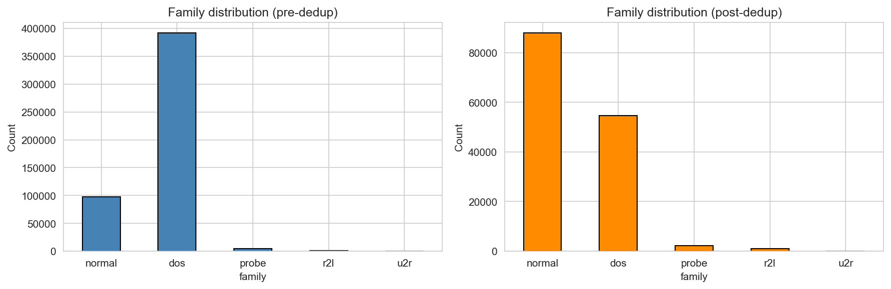
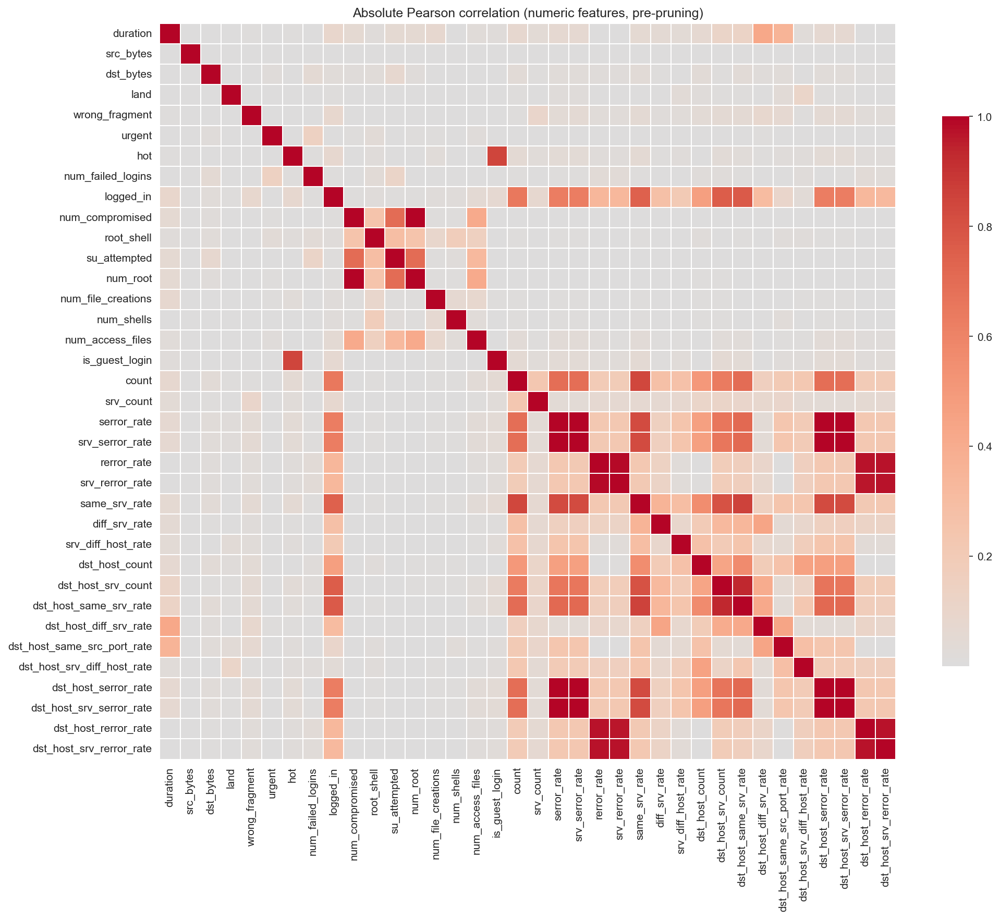

# Network Guardian IDS

A Hybrid Machine Learning Approach to Multi Class Network Intrusion Detection

INTRODUCTION TO INTELLIGENT SYSTEMS
CCINSYSL

Submitted by

Kit Dustin [Complete surname first name and middle initial]

Markie [Complete surname first name and middle initial]

Amber [Complete surname first name and middle initial]

Kenneth [Complete surname first name and middle initial]

Dwayne [Complete surname first name and middle initial]

Submitted to
[Professor full name]
Professor

OCTOBER 2026

## I Introduction

### 1.1 Background and problem statement

Network intrusion detection requires distinguishing legitimate connections from activity that threatens the confidentiality, integrity, or availability of a system. A machine learning classifier approaches this task by learning relationships between connection attributes and labeled outcomes. Network Guardian IDS investigates this approach through a five class classification problem using network connection records. The project compares alternative learning methods and examines whether their errors differ across common and rare attack families.

The benchmark task concerns connection level classification rather than direct inspection of live packet streams. KDD Cup 1999 draws on a simulated network environment associated with the 1998 DARPA intrusion detection evaluation. This origin provides a reproducible research setting but limits the conclusions that can be drawn about current operational traffic (ACM SIGKDD, n.d.). The project therefore evaluates a research prototype rather than claiming production readiness.

### 1.2 Attack families

The target classes are normal, denial of service, probe, remote to local, and user to root. Denial of service attacks interfere with service availability, probing seeks information about hosts or services, remote to local attacks seek unauthorized access from a remote system, and user to root attacks seek elevated privileges from an existing user context (ACM SIGKDD, n.d.). Each record receives one family label; the project does not infer the full attack sequence from that label alone.

Class imbalance is central to the research problem. The prepared training partition contains 65,874 normal connections but only 39 user to root examples. A model can perform well on frequent classes while failing on the rarest category. Accordingly, the comparison emphasizes Macro F1 and class level recall alongside aggregate measures. The operational significance of a missed attack and the burden of a false alarm must both be considered.

### 1.3 Objectives and research questions

The primary objective is to compare Random Forest, XGBoost, and TabNet using a shared prepared representation and a frozen training and test partition. The study asks how the three approaches differ in overall classification quality, detection of rare attack families, computational requirements, and the explanations available to an analyst. A second objective is to document the preparation decisions and execution difficulties that affect reproducibility.

The comparison is designed around one prepared pipeline. It does not isolate the causal contribution of each transformation because no preprocessing ablation is currently included. Any claim that a particular transformation improves detection will require a separate controlled experiment. Final model recommendations will be based on confirmed training and evaluation artifacts rather than anticipated rankings.

### 1.4 System scope

The prototype combines a Next.js dashboard, a Node.js Express service, and a Python inference bridge. The implemented bridge applies the saved preprocessing artifacts and preserves the feature ordering expected by the selected model. The interface accepts raw connection statistics and returns an attack family, a confidence percentage, a threat indicator, and the model identifier. Frontend scaffolding has been delivered, and the Express to Python inference bridge has been implemented. A real Random Forest API request has been verified using Amber's handed off model. Full dashboard integration remains pending; the frontend still uses its mock switch until Amber completes integration (Network Guardian IDS Team, 2026d, 2026g).

## II Data Understanding and Preparation

### 2.1 Dataset characteristics

The repository contains a KDD Cup 1999 style training file with 494,021 records, 41 input features, and one attack label column. Local profiling found no missing cells. Three input fields are categorical strings: protocol_type, service, and flag. The remaining 38 fields are numerical, including counts, indicators, and rates. The local manifest contains 22 attack mappings; normal is added explicitly, producing 23 observed raw labels and five target families. The file is described here by its verified schema and record count rather than the inconsistent KDDTrain+ name used in some earlier reports (Network Guardian IDS Team, 2026a).

**Table 1 Class distribution before and after deduplication and in the frozen split**

| Class | Raw | Prepared | Training | Test |
| --- | --- | --- | --- | --- |
| Normal | 97,278 | 87,832 | 65,874 | 21,958 |
| DoS | 391,458 | 54,571 | 40,928 | 13,643 |
| Probe | 4,107 | 2,130 | 1,598 | 532 |
| R2L | 1,126 | 999 | 749 | 250 |
| U2R | 52 | 52 | 39 | 13 |
| Total | 494,021 | 145,584 | 109,188 | 36,396 |

Source: Notebook 01 execution and data/processed/split_indices.json. Removing 348,437 repeated feature vectors reduced the dataset by approximately 70.5 percent. U2R retained only 52 records across the prepared dataset. The small support means that a single incorrect U2R prediction can noticeably change the reported test recall.

### 2.2 Feature description

Basic connection attributes describe traffic volume and status. Content attributes summarize activity within a connection, while time based and host based traffic attributes describe related connections. All 41 fields in Table 2 are candidate inputs before feature removal; label is the target, not a predictor. Numerical ranges are observed minima and maxima in the supplied raw file, not validation limits for future network traffic. Categories number three for protocol_type, 66 for service, and 11 for flag in this local file.

**Table 2 Raw feature dictionary with locally observed values**

| Feature name | Type and range | Description |
| --- | --- | --- |
| duration | Numeric; 0 to 58,329 | Connection length in seconds |
| protocol_type | Category; 3 values | Transport or network protocol |
| service | Category; 66 values | Destination service category |
| flag | Category; 11 values | Connection status category |
| src_bytes | Numeric; 0 to 693,375,640 | Bytes toward destination |
| dst_bytes | Numeric; 0 to 5,155,468 | Bytes toward source |
| land | Numeric; 0 to 1 | Same host and port indicator |
| wrong_fragment | Numeric; 0 to 3 | Invalid fragment count |
| urgent | Numeric; 0 to 3 | Urgent packet count |
| hot | Numeric; 0 to 30 | Sensitive activity indicator count |
| num_failed_logins | Numeric; 0 to 5 | Failed authentication count |
| logged_in | Numeric; 0 to 1 | Successful authentication indicator |
| num_compromised | Numeric; 0 to 884 | Compromise indicator count |
| root_shell | Numeric; 0 to 1 | Root shell indicator |
| su_attempted | Numeric; 0 to 2 | Superuser command indicator |
| num_root | Numeric; 0 to 993 | Root access count |
| num_file_creations | Numeric; 0 to 28 | File creation count |
| num_shells | Numeric; 0 to 2 | Shell prompt count |
| num_access_files | Numeric; 0 to 8 | Access control file operation count |
| num_outbound_cmds | Numeric; 0 to 0 | Outbound FTP command count |
| is_host_login | Numeric; 0 to 0 | Host login indicator |
| is_guest_login | Numeric; 0 to 1 | Guest login indicator |
| count | Numeric; 0 to 511 | Recent same host connections |
| srv_count | Numeric; 0 to 511 | Recent same service connections |
| serror_rate | Numeric; 0 to 1 | Same host SYN error fraction |
| srv_serror_rate | Numeric; 0 to 1 | Same service SYN error fraction |
| rerror_rate | Numeric; 0 to 1 | Same host rejection fraction |
| srv_rerror_rate | Numeric; 0 to 1 | Same service rejection fraction |
| same_srv_rate | Numeric; 0 to 1 | Same host same service fraction |
| diff_srv_rate | Numeric; 0 to 1 | Same host other service fraction |
| srv_diff_host_rate | Numeric; 0 to 1 | Same service other host fraction |
| dst_host_count | Numeric; 0 to 255 | Host window connection count |
| dst_host_srv_count | Numeric; 0 to 255 | Host window same service count |
| dst_host_same_srv_rate | Numeric; 0 to 1 | Host window same service fraction |
| dst_host_diff_srv_rate | Numeric; 0 to 1 | Host window other service fraction |
| dst_host_same_src_port_rate | Numeric; 0 to 1 | Host window same source port fraction |
| dst_host_srv_diff_host_rate | Numeric; 0 to 1 | Service window other host fraction |
| dst_host_serror_rate | Numeric; 0 to 1 | Host window SYN error fraction |
| dst_host_srv_serror_rate | Numeric; 0 to 1 | Host service SYN error fraction |
| dst_host_rerror_rate | Numeric; 0 to 1 | Host window rejection fraction |
| dst_host_srv_rerror_rate | Numeric; 0 to 1 | Host service rejection fraction |

Source: data/raw/kddcup.names.txt, local profiling of data/raw/kddcup.csv, and the benchmark feature descriptions. The repository spelling is_host_login is retained. The indicators and counts are stored numerically even where their semantic role is categorical or binary.

### 2.3 Target mapping and duplicate removal

The pipeline parses the raw feature manifest, appends the implicit label column, and maps attack names to their canonical families. Normal is injected into the mapping because it is absent from the attack manifest. Duplicate removal compares the 41 input features rather than the label. When identical feature vectors have different labels, the first record is retained. This policy reduces repeated examples across the subsequent split but also requires scrutiny of any conflicting labels that may be discarded.

### 2.4 Constant and correlated feature removal

The reproduced notebook removes num_outbound_cmds and is_host_login because they are constant in this file. It then computes absolute Pearson correlations among numerical fields, using a threshold greater than 0.90 and retaining the earlier field in column order. The reproduced removal list is dst_host_rerror_rate, dst_host_serror_rate, dst_host_srv_count, num_compromised, rerror_rate, serror_rate, srv_rerror_rate, and srv_serror_rate. This leaves 28 numerical fields and three categorical fields before encoding. These runtime counts take precedence over inconsistent intermediate counts in the earlier preparation report.

Constant detection and correlation pruning are performed before the frozen split in the current notebook. Although these steps do not use the target labels directly, they inspect the entire feature pool, including future test records. The manuscript therefore does not claim that every preprocessing choice was fit exclusively within training folds. Future validation should fit data dependent selection and preprocessing within each training fold to assess the effect of this design limitation.

### 2.5 Transformation and encoding

The duration, src_bytes, and dst_bytes fields receive log(1 + x) transformations to compress large numerical ranges while retaining zero values. Service is frequency encoded using the training partition, with unseen services mapped to zero. Protocol and flag are one hot encoded using training fitted categories; unknown values produce zeros for the corresponding block. The final representation contains 28 numerical features, one service frequency, three protocol indicators, and 11 flag indicators, totaling 43 ordered inputs.

### 2.6 Split and scaling

A stratified 75 percent training and 25 percent test split uses random state 42. The resulting arrays contain 109,188 training rows and 36,396 test rows. Features are float64 and labels are fixed width Unicode. A StandardScaler is fit on the training partition and saved for the intended TabNet inference pipeline. The current TabNet training functions receive the loaded engineered arrays without applying that saved scaler. Training and inference transformations must be reconciled before integration. Tree models use the unscaled engineered representation. The saved JSON manifests specify the input order, class order, and frozen split, while saved encoders provide the inference transformation.

The encoders and scaler are trained on the complete training partition rather than being refitted inside each cross validation fold. Consequently, validation fold covariates contribute to these preprocessing statistics. The test partition is excluded from their fitting, but cross validation should be interpreted with this qualification. A future fold fitted pipeline would provide a stricter estimate of generalization during model selection.

## III Machine Learning Model Development

### 3.1 Random Forest

Random Forest combines decision trees built with randomness in their training samples and split features. Aggregating multiple trees provides a bagging baseline for the project (Breiman, 2001). The project contract uses bootstrap sampling, out of bag diagnostics, and selectable class weighting. These mechanisms support model comparison but do not guarantee reliable detection of extremely rare attacks.

The contracted search budget is 20 Optuna trials with five stratified folds. The search covers 100 to 500 trees in increments of 50, depths from 5 to 30 or unlimited depth, split sizes from 2 to 20, leaf sizes from 1 to 10, square root or logarithmic feature sampling, Gini or entropy criteria, and balanced or balanced subsample class weights. Random state 42, parallel execution, bootstrap sampling, and out of bag estimation are fixed. Tomek Links is applied only to each fold training subset. This describes the specified search design; the supplied RF execution handoff provides the selected parameters reported below (Network Guardian IDS Team, 2026b).

Amber has now uploaded a Random Forest execution handoff and model sidecar on branch role-3-phase-2, commit 3706260, in open PR 13. The selected configuration uses 350 trees, depth 15, entropy, square root feature sampling, minimum split size 8, minimum leaf size 3, and balanced class weights. Trial 17 is the selected trial. These are the supplied run parameters rather than hypothetical settings (Network Guardian IDS Team, 2026f).

The sidecar records CV Macro F1 of 0.950540, standard deviation 0.021178 across five actual fold scores, and out of bag Macro F1 of 0.949575. Its pooled validation recalls are 0.999605 for normal, 0.999805 for DoS, 0.992491 for probe, 0.958611 for R2L, and 0.820513 for U2R. The RF branch reconstructs these recalls from saved validation targets and predictions. These values describe the handed off training study; they are not held out test scores or evidence that RF is the best of all three models.

The reported CV standard deviation exceeds the contractual 0.02 threshold by approximately 0.001178. The report contains both an approval statement and a pending sign-off item, while PR 13 remains open. Acceptance is therefore recorded as awaiting an explicit review decision. The threshold deviation is retained in this manuscript rather than dismissed as rounding noise.

[To be completed after confirmed handoff: RF held out test metrics, measured runtime, and explicit Kit acceptance of the threshold deviation.]

### 3.2 XGBoost

XGBoost is a regularized gradient tree boosting framework that builds an additive ensemble through sequential optimization (Chen & Guestrin, 2016). The implementation assigns class weighted sample weights and evaluates candidate configurations using five fold stratified validation. The search budget is 30 trials and the objective is the mean Macro F1 across validation folds. Validation based early stopping uses a patience of 20 rounds.

The search varies learning rate, tree depth, minimum child weight, split regularization, row and column sampling, L1 and L2 regularization, maximum delta step, and the number of trees. The implemented learning rate range is 0.01 to 0.15 and tree depth ranges from 3 to 10. Candidate ensembles use 100 to 300 trees in steps of 50. After selection, the implementation refits on the cleaned training pool with class weights recalculated after resampling. The final refit does not consult the held out test partition (Network Guardian IDS Team, 2026b).

[To be completed after confirmed handoff: XGBoost selected parameters, verified CV summary, runtime, and artifact handoff from Kenneth.]

### 3.3 TabNet

TabNet applies sequential attention to feature selection in a neural network for tabular data. Its attention masks offer a model specific view of feature usage (Arik & Pfister, 2019). The project implementation uses CPU execution, an Adam optimizer with learning rate 0.02, at most 30 epochs, and validation based early stopping with patience 10. Architecture tuning includes decision and attention widths, decision steps, attention relaxation, sparsity regularization, transformer sharing, momentum, mask type, and batch sizes.

TabNet uses 20 configured Optuna trials and three stratified validation folds. With 39 U2R training records, three folds place approximately 13 examples in each validation fold, compared with roughly seven or eight under five folds. This increases support per fold but does not establish that the rare class estimate is stable. The different fold counts must remain visible when comparing the algorithms. Tomek Links is restricted to fold training subsets. The final refit includes an internal 10 percent validation subset for early stopping rather than unrestricted training on the entire pool.

Dwayne has supplied a TabNet execution report, a subsequent verification report, and trial and CV CSV outputs. The handoff records completed training and successful model loading on his machine. Final numerical results are reserved for the evaluation sections after the reported summary, metadata, and exported values are reconciled. In the current code, Optuna intermediate values are running means across completed folds; an export of these intermediate values must not be treated as independent fold scores (Network Guardian IDS Team, 2026c).

[To be completed after confirmed handoff: Confirmed TabNet summary, selected parameters, corrected interpretation of fold statistics, runtime, and held out test results.]

### 3.4 Common training protocol and imbalance handling

The implementations use a shared random state and persist optimization studies for traceability. Optuna selects configurations according to validation Macro F1; pruning can stop unpromising trials before they consume the full budget (Akiba et al., 2019). Tomek Links removes selected boundary examples from fold training data, while validation subsets are not resampled. Class weights increase the contribution of less frequent classes. The final test partition is reserved for Notebook 03 and is not passed to model tuning functions.

Macro F1 is the arithmetic mean of the five class F1 values. For each class, precision measures how many predicted members are correct, recall measures how many actual members are recovered, and F1 balances precision and recall. Equal class weighting prevents the most frequent category from dominating the summary. Per class support and confusion matrices remain necessary because the same Macro F1 can arise from different error patterns.

### 3.5 Backend implementation and integration verification

The backend implements POST /api/analyze on localhost port 5000. It validates the 31 raw categorical and numerical request fields before starting the repository virtual environment Python interpreter. The bridge applies logarithmic transformations and the frozen encoders, reconstructs the 43 feature columns in their stored order, checks model metadata, and decodes probability columns using the model class identifiers. This avoids dependence on JSON key order and prevents incorrect family decoding when a classifier uses a different probability column order.

Successful requests return a family label, confidence percentage, threat indicator, and model identifier. Invalid requests return HTTP 400. Missing artifacts, bridge failures, invalid model outputs, and timeouts return HTTP 500 with a structured error. The frontend must treat an error envelope as a failed request; its default normal field is not a prediction. The service uses bounded request and response sizes and a per-request timeout.

Functional verification passed 10 Node API tests and three Python bridge tests. A real HTTP inference request using the RF artifact returned a valid response, and reversing the raw JSON key order preserved that response. These checks establish tested interface behavior, not classifier accuracy. No training or test-set evaluation was performed during backend verification (Network Guardian IDS Team, 2026g).

XGBoost support is implemented but its real model validation awaits the owner artifact. TabNet is guarded because the contract requires scaled inference while the existing training code uses unscaled engineered arrays. Kit must confirm the matching training and inference representation before this route is enabled. The backend handoff is published in draft PR 14; dashboard integration and main-branch acceptance remain pending.

## IV Model Metadata

Table 3 records fixed design information and the current RF handoff status. Selected hyperparameters, actual execution times, and performance values will be taken from confirmed model sidecars and execution reports. Training recall stored under per_class_recall_train must remain distinct from validation recall and test recall.

**Table 3 Model configuration and evidence readiness**

| Item | Random Forest | XGBoost | TabNet |
| --- | --- | --- | --- |
| Family | Bagging | Gradient boosting | Tabular attention |
| Input features | 43 | 43 | 43 |
| Training rows before resampling | 109,188 | 109,188 | 109,188 |
| Reserved test rows | 36,396 | 36,396 | 36,396 |
| Configured trials | 20 | 30 | 20 |
| Validation folds | 5 | 5 | 3 |
| Random state | 42 | 42 | 42 |
| Selected parameters | Trial 17 see 3.1 | Pending handoff | Pending reconciliation |
| Model artifact | rf_baseline.joblib | xgb_optuna.joblib | tabnet_best.zip |
| Measured runtime | Pending | Pending | Pending |
| Test metrics | Pending | Pending | Pending |

Sources: src/models.py, the three model contracts, data/processed manifests, and the Role 5 handoff reports. Configured budgets describe the intended study and must not be substituted for the actual completed and pruned trial counts.

## V Model Comparison and Evaluation

### 5.1 Comparative results

[To be completed after confirmed handoff: Populate the comparison from outputs/02_training/model_comparison.csv, verified model metadata, and outputs/03_evaluation/per_class_metrics.csv.]

**Table 4 Available validation summary and pending test comparison**

| Measure | Random Forest | XGBoost | TabNet |
| --- | --- | --- | --- |
| CV Macro F1 and dispersion | 0.950540 and SD 0.021178 | Pending | Pending |
| Test Macro F1 | Pending | Pending | Pending |
| Test weighted F1 | Pending | Pending | Pending |
| Normal recall | Pending | Pending | Pending |
| DoS recall | Pending | Pending | Pending |
| Probe recall | Pending | Pending | Pending |
| R2L recall | Pending | Pending | Pending |
| U2R recall | Pending | Pending | Pending |
| Training time | Pending | Pending | Pending |
| Prediction time | Pending | Pending | Pending |

The RF entry is taken from the training handoff metadata in open PR 13. All recall rows in Table 4 refer to held out test recall and remain pending. RF pooled validation recalls are reported separately in Section 3.1. TabNet summary reconciliation and XGBoost handoff are required before completing a three model comparison (Network Guardian IDS Team, 2026f).

### 5.2 Error analysis

The final error analysis will report which attack families are confused with normal traffic and with one another. A false negative in attack detection represents malicious traffic classified as normal; a false positive represents normal traffic classified as an attack. Errors between two attack families also matter for the multiclass task and should be distinguished from the binary normal versus threat distinction. Counts and class support will accompany rates, particularly for the 13 U2R test examples.

[To be completed after confirmed handoff: Insert observed confusion patterns and the exact corresponding counts from Dwayne's held out evaluation.]

### 5.3 Overfitting and generalization

Training performance, cross validation performance, and test performance measure different conditions. A training to validation gap can indicate optimism but cannot by itself prove severe overfitting. The analysis will consider the final refit procedure, trial selection, fold construction, and the preprocessing limitations identified in Section II. A high training recall for a rare class does not establish that the class generalizes to unseen records.

[To be completed after confirmed handoff: Compare separately labeled training, validation, and test measures after the TabNet summary and fold exports are reconciled.]

### 5.4 Model recommendation

No final model recommendation is established at this stage. Selection will weigh validation performance, rare class detection, runtime, interpretability, and deployment requirements. Held out test performance will characterize the selected approaches without using that partition for additional tuning. A numerical lead must be interpreted in light of low class support and different validation fold counts.

## VI Results and Visualizations

The available preparation figures summarize class balance and numerical correlation. They document the input data and feature selection context, rather than classifier performance. Final confusion matrices, precision recall curves, and explanation plots will be added when the evaluation handoff is confirmed.

**Figure 1 Class distribution before and after deduplication**

Source: outputs/01_eda/family_distribution.png, generated by Notebook 01. Raw DoS frequency is reduced substantially by duplicate removal, while U2R remains rare.

**Figure 2 Absolute Pearson correlation before correlation pruning**

Source: outputs/01_eda/correlation_heatmap.png, generated by Notebook 01. Strongly correlated fields motivate removal of later columns under the fixed 0.90 threshold.

### 6.1 Pending evaluation and explanation figures

[To be completed after confirmed handoff: Add RF, XGBoost, and TabNet confusion matrices; U2R and R2L precision recall curves; model comparison plot; tree model SHAP summaries and a local explanation; and a TabNet attention mask.]

SHAP attributes a prediction to input features through an additive explanation framework (Lundberg & Lee, 2017). TabNet masks indicate feature selection within its own architecture. These explanations describe model behavior and should not be presented as causal proof that a connection is malicious.

## VII Discovery Log

The discovery process combines source attributed development reports with locally reproduced onboarding checks. Earlier events are reported by their original contributors; they are not presented as experiments independently rerun by every member. The log records both successful corrections and unresolved evidence questions.

### 7.1 Environment and schema issues

Kit's environment report records an installation failure when the pinned package set was attempted on Python 3.13. Recreating the environment on Python 3.11.9 resolved the reported compatibility problem. The preparation report also records an incorrect assumption about the manifest length: the names file has an attack header and 41 feature definitions, while the label column is implicit. Appending the label and explicitly mapping normal traffic corrected the schema and target coverage problems (Network Guardian IDS Team, 2026a).

### 7.2 Label serialization and onboarding verification

Local onboarding reproduced the prescribed training and test shapes but initially failed when loading labels with allow_pickle=False. A duplicate final export cell overwrote Unicode labels with object arrays. The generated local files were corrected, and Kit subsequently removed the duplicate cell. The fixed notebook was rerun successfully with Unicode labels, expected shapes, and all four frozen input hashes matching the guide. This experience shows why artifact validation must occur after the last export operation.

### 7.3 TabNet artifact verification

Dwayne reports a duplicate zip extension in the saved TabNet model filename and a verification cell issue involving the project paths. The model file was renamed to the contracted path, and the later verification report records successful model loading. The handoff also distinguishes training recall metadata from the previously expected validation recall field. These are artifact and reporting issues; they do not establish test performance (Network Guardian IDS Team, 2026c).

### 7.4 Lessons and remaining evidence

The documentation process removed unsupported claims about a winning model and failed experiments that lacked execution evidence. Reports, source code, and exported statistics must agree before empirical claims enter the final paper. The RF training handoff is available in open PR 13. Outstanding contributions include its explicit acceptance, the XGBoost execution handoff, reconciliation of TabNet fold reporting, full test evaluation, measured runtimes, and final explanation figures. Each contribution will identify its source artifact and distinguish training, validation, and test measures.

### 7.5 Backend verification and handoff

Backend development replaced unchecked input, request key order based feature assembly, and incomplete subprocess handling with schema validation, saved preprocessing, metadata checks, and consistent failure responses. The 13 automated functional checks and real RF API smoke test passed. The handoff remains a draft pending review, and the TabNet preprocessing discrepancy is recorded for Kit rather than bypassed by changing metadata (Network Guardian IDS Team, 2026g).

## VIII Executive Summary

### What problem did we set out to solve and why does it matter

We investigate five class network intrusion detection, comparing three learning approaches while accounting for missed rare attacks and false alarms. The goal is an evidence based research comparison rather than a claim of production security.

### What did we discover about the data that shaped our decisions

The supplied file has 494,021 rows, substantial duplication, and only 52 U2R records. Preparation produced 145,584 unique feature vectors, a frozen 75 to 25 split, and 43 encoded inputs. Rare class support remains a material limitation.

### Which approaches did we compare and how did we judge them

The comparison covers Random Forest, XGBoost, and TabNet. Macro F1 gives each class equal weight; recall, confusion matrices, runtime, and explanations provide further context. RF validation Macro F1 is 0.950540 in its submitted handoff; test performance and the full comparison are pending. Tree models use five folds and TabNet uses three.

### What do we recommend and what evidence supports it

The recommendation remains pending. Confirmed training summaries and held out evaluation are needed before naming a preferred model or reporting a comparative advantage.

### What are the limitations of our work and what would we do next

The historical simulated benchmark, limited rare class support, and preprocessing performed before or outside individual folds limit generalization claims. Future work should use fold fitted preprocessing, controlled ablations, newer traffic, and measured inference cost.

### What was our biggest mistake or surprise and what did we learn from it

A reproduced duplicate export cell reversed the intended label serialization fix. The corrected upstream notebook now passes validation. The team learned to check generated artifacts after the complete workflow; the final largest lesson will incorporate all execution reports.

## IX Reflection

Each member will provide an individual reflection based on their own contribution and experience. The reflections will address learning about intrusion detection, data preparation, model comparison, encountered challenges, responses to unexpected results, evaluation beyond accuracy, real world applicability, and improvements with additional time.

### Kit Dustin

[To be completed after confirmed handoff: Insert Kit Dustin's own reflection after contribution review. Target 400 to 700 words in the final paper.]

### Markie

[To be completed after confirmed handoff: Insert Markie's own reflection after contribution review. Target 400 to 700 words in the final paper.]

### Amber

[To be completed after confirmed handoff: Insert Amber's own reflection after contribution review. Target 400 to 700 words in the final paper.]

### Kenneth

[To be completed after confirmed handoff: Insert Kenneth's own reflection after contribution review. Target 400 to 700 words in the final paper.]

### Dwayne

[To be completed after confirmed handoff: Insert Dwayne's own reflection after contribution review. Target 400 to 700 words in the final paper.]

## X References

ACM SIGKDD. (n.d.). KDD Cup 1999 computer network intrusion detection. https://www.kdd.org/kdd-cup/view/kdd-cup-1999/Tasks

Akiba, T., Sano, S., Yanase, T., Ohta, T., & Koyama, M. (2019). Optuna: A next-generation hyperparameter optimization framework [Preprint]. arXiv. https://arxiv.org/abs/1907.10902

Arik, S. O., & Pfister, T. (2019). TabNet: Attentive interpretable tabular learning [Preprint]. arXiv. https://arxiv.org/abs/1908.07442

Breiman, L. (2001). Random forests. Machine Learning, 45, 5-32. https://doi.org/10.1023/A:1010933404324

Chen, T., & Guestrin, C. (2016). XGBoost: A scalable tree boosting system. Proceedings of the 22nd ACM SIGKDD International Conference on Knowledge Discovery and Data Mining, 785-794. https://doi.org/10.1145/2939672.2939785

Lundberg, S. M., & Lee, S.-I. (2017). A unified approach to interpreting model predictions [Preprint]. arXiv. https://arxiv.org/abs/1705.07874

Network Guardian IDS Team. (2026a). Environment and data preparation reports and reproducible artifacts [Project documentation]. docs/reports/role-1-phase-1-kit-environment-setup.md; docs/reports/role-1-phase-2-kit-data-preparation.md; notebooks/01_EDA_and_Data_Prep.ipynb; data/processed/split_indices.json; data/processed/feature_names.json.

Network Guardian IDS Team. (2026b). Model architecture and execution specifications [Project documentation]. src/models.py; docs/contracts/role-3-rf-architecture-spec.md; docs/contracts/role-4-training-execution-spec.md; docs/contracts/role-5-training-execution-spec.md.

Network Guardian IDS Team. (2026c). Role 5 TabNet execution and verification reports [Project documentation]. docs/reports/role-5-phase-2-dwyane-tabnet-execution.md; docs/reports/role-5-tabnet-training-verification-report.md; outputs/02_training/optuna_tabnet_trials.csv; outputs/02_training/tabnet_cv_scores.csv.

Network Guardian IDS Team. (2026d). Frontend scaffold and API data contract [Project documentation]. docs/reports/role-3-phase-1-amber-frontend-scaffold.md; docs/contracts/api_data_contract.md.

Network Guardian IDS Team. (2026e). Role 2 documentation and setup verification [Project documentation]. docs/reports/role-2-phase-1-markie-documentation-scaffolding.md; docs/reports/discovery_log.md.

Network Guardian IDS Team. (2026f). Random Forest training handoff and metadata [Project documentation, open PR 13]. Branch role-3-phase-2, commit 3706260; docs/reports/role-3-phase-2-amber-rf-baseline.md; models/rf_baseline.meta.json. https://github.com/Dustin-Martinez/network-guardian-ids/pull/13

Network Guardian IDS Team. (2026g). Backend bridge implementation and verification [Project documentation, draft PR 14]. docs/reports/role-2-phase-2-markie-backend-bridge.md; server/server.js; server/predict_bridge.py; server/validate.js; server/tests. https://github.com/Dustin-Martinez/network-guardian-ids/pull/14

UCI KDD Archive. (1999). KDD Cup 1999 data. https://kdd.ics.uci.edu/databases/kddcup99/kddcup99

### AI Tool Disclosure

OpenAI Codex assisted with repository setup, source review, document drafting, formatting, preparation-artifact verification, and backend implementation and functional testing. AI assistance was used to organize source material and identify reporting inconsistencies; it did not supply missing experimental results. Dwayne's handoff separately discloses ChatGPT assistance in troubleshooting and interpreting errors. The team remains responsible for checking the manuscript, confirming numerical evidence, completing personal reflections, and reconciling the final references before submission.
